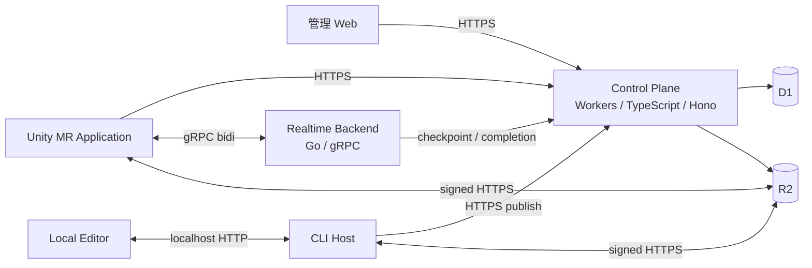

# Unframe アーキテクチャ

このドキュメントは Unframe モノレポの目標構成を示す一次資料です。Backend component 間の境界は [`app/server/ARCHITECTURE.md`](./app/server/ARCHITECTURE.md)、Control Plane と Realtime Backend の内部設計はそれぞれ [`app/server/control-plane/ARCHITECTURE.md`](./app/server/control-plane/ARCHITECTURE.md) と [`app/server/realtime/ARCHITECTURE.md`](./app/server/realtime/ARCHITECTURE.md)、開発フローは [`CONTRIBUTING.md`](./CONTRIBUTING.md)、個別の判断背景は [`docs/decisions/`](./docs/decisions/) を参照してください。

## 全体像

Unframe は、MR プレゼンテーションをローカル Source から作成し、Unity クライアントで表示するプロダクトです。Backend は durable state を扱う Control Plane と、低遅延の session state を扱う Realtime Backend に分離します。



## ディレクトリ構成

```text
unframe/
├── app/
│   ├── web/                      # React 19 management SPA
│   ├── local-editor/             # Local Source editor / Unity Preview
│   ├── server/
│   │   ├── control-plane/        # Workers / TypeScript / Hono / D1 / R2
│   │   ├── realtime/             # Go / gRPC / container
│   │   └── integration/          # Backend component 間 E2E
│   └── unity/                    # Unity MR Application
├── lp/                           # SvelteKit Landing Page
├── packages/
│   ├── contracts/                # 将来の API / protocol contract 境界
│   ├── api-client-csharp/        # C# client 成果物の配置予定地
│   └── config/                   # 共有 TypeScript / Git hook 設定
├── scripts/                      # 開発・CI・ドキュメント同期の実処理
└── docs/                         # ADR・計画・同期ドキュメント
```

## 各コンポーネントの責務

### `app/server/control-plane`

- Cloudflare Workers / TypeScript / Hono を使用する。
- 認証・認可、durable resource、D1/R2、asset lifecycle、session bootstrap の authority を持つ。
- HTTP handler から D1/R2 binding を直接操作せず、application service と adapter を分離する。

### `app/server/realtime`

- Go / gRPC の独立した container application とする。
- Unity との bidirectional stream、session 中の canonical state、fan-out、backpressure を担当する。
- Presenter が認識した入力の有効性、Cue / Action、Timeline / Timer、Step 遷移を確定する。入力世代、共有演出全体の pause、到達済み Step の開始状態への復元は [ADR-0027](./docs/decisions/0027-presenter-recognition-and-runtime-authority.md) の採用仕様であり、現行実装・生成契約には未反映である。
- hot path は Control Plane、D1、R2 に依存せず、checkpoint と completion のみを Control Plane へ永続化する。

### `app/web`

- React 19 SPA として認証・device 承認、公開済み Dist 確認とルーム作成を担当する。
- Hono RPC client と TanStack Query を通して Control Plane を利用する。

### `app/local-editor`

- ローカル Source の編集・保存・履歴、build 要求、Unity Preview と CLI を通す公開操作を担当する。
- 静的成果物は CLI Host が配信し、filesystem・credential・build generation は CLI が所有する。

### `app/unity`

- Unity / C# で MR 表示と realtime session 参加を担当する。
- Presenter が Gesture / Zone を認識し、認識開始時の Step と入力世代に結び付けて送信する。描画用 Pose の送信と認識を分離し、共有状態の確定は Realtime に委ねる。この採用仕様の実装は未着手であり、現行の生成 client 接続・検証状況は [Unity README](./app/unity/README.md) を参照する。

### `lp`

- SvelteKit + `adapter-static` による静的 Landing Page とする。
- 管理 Web とは deployment と依存関係を分離する。

## 契約生成パイプライン

旧 Go/Huma HTTP API の OpenAPI、生成 TypeScript client、sqlc 生成物は削除済みです。`packages/contracts/` は次の Control Plane OpenAPI と Realtime Protocol Buffers の共有境界として残します。

新しい契約を導入する変更では、同時に次を定義します。

1. source of truth と versioning
2. TypeScript / Go / C# の生成先
3. 手書き adapter との境界
4. consumer の更新手順
5. CI の生成 drift 検査

生成物は手編集せず、実装コードは Backend component 間で共有しません。

## ツールチェインとタスク実行

ツールチェインは Nix flake で固定し、JavaScript workspace は pnpm で管理します。現在の repository-wide entrypoint は次のとおりです。

| 用途                               | コマンド                                                   |
| ---------------------------------- | ---------------------------------------------------------- |
| 開発環境                           | `nix develop`                                              |
| 依存関係と Git hook のセットアップ | `nix run .#setup`                                          |
| 全体品質ゲート                     | `nix run .#check`                                          |
| Web の検査・修正                   | `nix run .#web` / `nix run .#web -- fix`                   |
| Local Editor の検査・修正          | `nix run .#local-editor` / `nix run .#local-editor -- fix` |
| LP の検査・修正                    | `nix run .#lp` / `nix run .#lp -- fix`                     |
| Notion 同期                        | `nix run .#notion-sync`                                    |
| flake の評価と formatter 検証      | `nix flake check`                                          |

Control Plane と Realtime の check entrypoint は実装済みです。開発・migration の手順は各 component の README を参照してください。自動 deployment workflow はありません。

### GitHub Actions

- `ci.yml`: 変更領域の検出と必須チェックの集約
- `control-plane.yml`: Control Plane の typecheck / test / deploy dry-run
- `realtime.yml`: Realtime の vet / lint / test / build / race
- `web.yml`: Web の check / test / build / E2E
- `local-editor.yml`: Local Editor の check / test / build / mock E2E
- `lp.yml`: LP の test / check / build
- `unity.yml`: Unity の静的検査
- `autofix.yml`: Control Plane / Realtime / Web / LP の format と lint fix
- `sync-notion.yml`: Notion 同期

## 移行状況

- [x] 旧 Go/Huma/Turso/R2 HTTP Backend を削除
- [x] 旧 OpenAPI、生成 TypeScript client、sqlc、旧 API ドキュメントを削除
- [x] 旧 Backend 専用の CI・生成・migration・dev entrypoint を削除
- [x] `packages/contracts/` を次の contract を定義するための境界として保持
- [x] Control Plane の HTTP 基盤を `app/server/control-plane/` に実装
- [x] Control Plane の OpenAPI、認証、D1/R2 adapter、Presentation / Asset / Session API を実装
- [x] Realtime Backend の gRPC 接続、JWT 認証、assignment fencing、page-change fan-out を実装
- [ ] Realtime の replay / resume、完全な Runtime 状態同期、永続化 callback の session lifecycle 接続を実装
- [ ] component 間 E2E を `app/server/integration/` に実装
